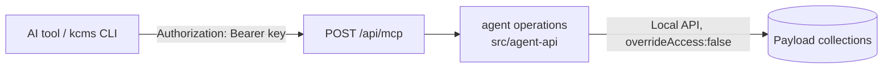

KDIGI CMS can be operated by AI agents (Claude Code, Codex, Cursor, VS Code Copilot, OMP, …) and from the terminal. Two pieces:

- **MCP endpoint** `POST /api/mcp`: a [Model Context Protocol](https://modelcontextprotocol.io) server built into the CMS. Agents call its tools to search, write, schedule, publish and audit content.
- **`kcms` CLI** (`@kdigi/kcms-cli`, source in `packages/kcms-cli`): a thin client of the same endpoint. It adds Markdown-file workflows, local image upload, one-command client setup, and a stdio bridge for clients that cannot call remote servers.

Both act **as the user who owns the API key**: that user's role and sites apply, exactly as in the admin.



## 1. Create an API key

Use a **dedicated user** per agent or person, with the lowest role that does the job:

| Role | Can do through MCP |
| --- | --- |
| `author` | Create and edit own posts as drafts; cannot publish |
| `editor` | Create, edit, publish, schedule and trash posts and pages of their sites |
| `admin` | Same as editor (account and site settings are not exposed as tools) |
| `super-admin` | Every site — **avoid**; `whoami` and the server log warn on every use |

1. Admin → **Users** → create the user (e.g. `ai-writer@example.com`), assign role and site(s).
2. Open the user → tick **Enable API Key** → copy the key → **Save**.
3. Store it as an environment variable where the agent runs: `export KCMS_API_KEY=change-me`.

Key sessions are restricted on **every** REST/GraphQL route, not only MCP: they cannot change email, password, API key, role or site membership, cannot create users, and cannot permanently delete anything (content can only be moved to the trash). Disable a leaked key by unticking **Enable API Key**.

## 2. Connect a client

The quickest path is the CLI, which writes the right file for each client and never puts the key in it:

```bash
npm install -g @kdigi/kcms-cli
export KCMS_API_KEY=change-me
kcms setup <claude-code|codex|cursor|vscode|omp|json> --url https://cms.example.com --write --with-skill
```

`--with-skill` also installs the [agent skill](https://github.com/kdigivn/kdigi-cms-open/blob/main/skills/kcms/SKILL.md), which teaches the editorial workflow (draft first, `expectedUpdatedAt`, SEO targets). Without `--write` the snippet is printed. Manual configuration per client:

### Claude Code

Project file `.mcp.json` ([docs](https://code.claude.com/docs/en/mcp), "Environment variable expansion in .mcp.json"):

```json
{
  "mcpServers": {
    "kdigi": {
      "type": "http",
      "url": "https://cms.example.com/api/mcp",
      "headers": { "Authorization": "Bearer ${KCMS_API_KEY}" }
    }
  }
}
```

User-wide: `claude mcp add --transport http --scope user kdigi https://cms.example.com/api/mcp --header "Authorization: Bearer $KCMS_API_KEY"` — your shell expands the variable, so the literal key ends up in `~/.claude.json`. Skill folder: `.claude/skills/kcms/`.

### Codex (CLI and IDE extension)

`~/.codex/config.toml` ([docs](https://developers.openai.com/codex/mcp)):

```toml
[mcp_servers.kdigi]
url = "https://cms.example.com/api/mcp"
bearer_token_env_var = "KCMS_API_KEY"
```

### Cursor

`.cursor/mcp.json` or `~/.cursor/mcp.json` ([docs](https://cursor.com/docs/mcp)):

```json
{
  "mcpServers": {
    "kdigi": {
      "url": "https://cms.example.com/api/mcp",
      "headers": { "Authorization": "Bearer ${env:KCMS_API_KEY}" }
    }
  }
}
```

### VS Code (GitHub Copilot agent mode)

`.vscode/mcp.json` ([docs](https://code.visualstudio.com/docs/copilot/chat/mcp-servers)) — VS Code prompts for the key once and keeps it in its secret storage:

```json
{
  "inputs": [{ "type": "promptString", "id": "kcms-api-key", "description": "KDIGI CMS API key", "password": true }],
  "servers": {
    "kdigi": {
      "type": "http",
      "url": "https://cms.example.com/api/mcp",
      "headers": { "Authorization": "Bearer ${input:kcms-api-key}" }
    }
  }
}
```

### OMP

`.omp/mcp.json` (project) or `~/.omp/agent/mcp.json` (user); OMP expands `${…}` when it discovers servers. Skill folder: `.omp/skills/kcms/` or `~/.omp/agent/skills/kcms/`.

```json
{
  "mcpServers": {
    "kdigi": {
      "type": "http",
      "url": "https://cms.example.com/api/mcp",
      "headers": { "Authorization": "Bearer ${KCMS_API_KEY}" }
    }
  }
}
```

### Other clients (stdio only)

Run the CLI as a local stdio server that forwards to the CMS:

```json
{
  "mcpServers": {
    "kdigi": {
      "command": "npx",
      "args": ["-y", "@kdigi/kcms-cli", "mcp"],
      "env": { "KCMS_URL": "https://cms.example.com", "KCMS_API_KEY": "${KCMS_API_KEY}" }
    }
  }
}
```

### Not supported yet

ChatGPT (web) connectors and Claude.ai (web) custom connectors require **OAuth 2.1** authorization; the endpoint only accepts API keys today. Use the desktop/CLI agents above, or the stdio bridge.

## 3. What the agent can do

| Tool | Purpose |
| --- | --- |
| `whoami`, `list_sites`, `get_site` | Identity, sites, content counts |
| `search_content`, `get_content` | Find and read posts/pages (Markdown body, SEO, `updatedAt`) |
| `create_post`, `create_page` | Create from Markdown (draft by default) |
| `update_post`, `update_page` | Partial update; requires `expectedUpdatedAt` |
| `set_status` | Publish, unpublish, schedule (future `publishedAt`) |
| `trash_content`, `restore_from_trash` | Reversible removal |
| `list_versions`, `restore_version` | History and undo |
| `list_taxonomies`, `create_taxonomy` | Categories and tags |
| `search_media`, `import_media_from_url`, `update_media_alt` | Images (raster formats only) |
| `list_shortcodes` | Reusable snippets for bodies |
| `seo_audit`, `get_seo_report` | SEO checks (same scorer as the admin) |
| `get_content_urls` | Admin URL for review; public URL when live |

Plus the resource `kcms://guide/content` (Markdown/shortcode/SEO rules) and the prompts `write-post` and `refresh-seo`.

Behaviour worth knowing:

- **Optimistic concurrency.** Every write to an existing document needs the `updatedAt` from the last read as `expectedUpdatedAt`. If anyone saved in between, the write fails with `conflict` and changes nothing.
- **Edit locks.** If an editor has the document open in the admin, writes fail with `locked` and name the editor; the lock is never stolen.
- **Locales.** Reads and writes default to `vi`; pass `locale: "en"` for English. A read of an untranslated locale returns `translated: false` instead of falling back to Vietnamese.
- **Legacy bodies.** Documents whose body is still old rich text are returned converted to Markdown with `bodySource: "legacy-converted"`; writing a new body needs `acknowledgeLegacyConversion: true`.
- **Drafts have no public URL.** Share `adminUrl` for review.
- Errors come back as `code: message` (`invalid`, `conflict`, `locked`, `forbidden`, `not_found`, `unauthorized`, `internal`) so the agent can correct itself.

## 4. CLI quickstart

```bash
kcms login --url https://cms.example.com      # prompts for the key, validates it, saves a profile
kcms posts get my-post -o my-post.md          # frontmatter + Markdown
$EDITOR my-post.md
kcms posts update my-post.md                  # only changed fields are sent
kcms media upload ./cover.webp --alt "Cover"
kcms seo audit
```

Full command list and the file format: [packages/kcms-cli/README.md](https://github.com/kdigivn/kdigi-cms-open/blob/main/packages/kcms-cli/README.md) and [skills/kcms/references/frontmatter.md](https://github.com/kdigivn/kdigi-cms-open/blob/main/skills/kcms/references/frontmatter.md).

## 5. Test the connection

```bash
curl -s https://cms.example.com/api/mcp \
  -H "Authorization: Bearer $KCMS_API_KEY" \
  -H 'Content-Type: application/json' -H 'Accept: application/json, text/event-stream' \
  -d '{"jsonrpc":"2.0","id":1,"method":"tools/call","params":{"name":"whoami","arguments":{}}}'

npx @modelcontextprotocol/inspector --cli https://cms.example.com/api/mcp --transport http \
  --header "Authorization: Bearer $KCMS_API_KEY" --method tools/list
```

## 6. Operating it

| Setting | Notes |
| --- | --- |
| `MCP_ENABLED` | Default `true`; `false` turns `/api/mcp` into a 404. See [configuration.md](/en/tham-khao/configuration/). |
| Transport | Streamable HTTP, stateless, JSON responses. `GET`/`DELETE` answer 405; JSON-RPC batches 400; bodies over 2 MB 413. |
| Reverse proxy | Allow at least 30 s per request (media imports download up to 25 MB). Rate-limit `/api/mcp` there — the CMS has no built-in rate limiting. See [deploy.md](/en/tham-khao/deploy/). |
| Audit | Every tool call logs one `agent-op` line (tool, user id, site, document id, ok/error code, duration) — never bodies or keys. |
| TLS | Use HTTPS: the key travels in a header. The CLI warns about plain `http://` to non-local hosts. |

## 7. Troubleshooting

| Symptom | Cause |
| --- | --- |
| `401` / `unauthorized` | Key missing, wrong, or **Enable API Key** unticked. Cookies and JWTs are not accepted on `/api/mcp`. |
| `404` on `/api/mcp` | `MCP_ENABLED=false`, or the URL is not the CMS base URL. |
| `invalid: Pass "site"` | The key's user belongs to several sites; pass `site` (or `--site`). |
| `forbidden` | The role does not allow it (e.g. an author publishing). |
| `not_found` | The site or document does not exist **or belongs to a site this key is not a member of** — other sites are invisible, not merely read-only. |
| `conflict` | Someone saved after your read. Re-read and re-apply. |
| `locked` | An editor has the document open in the admin. |
| Client shows no tools | Check the client log; most clients need a restart or an approval after the config changes. |
